# ambientCG: Tiles materials

**40 assets from [ambientCG](https://ambientcg.com), dedicated to the public domain under [CC0](https://docs.ambientcg.com/license/).** Use them in any game, free or paid, and change them however you like; no credit is needed.

PBR materials as 1K and 2K JPG maps (colour, normal GL and DX, roughness, AO, displacement), one folder per resolution. 878.0 MB in all.

This is a copy kept by [zuujis-cc0](https://github.com/zuujis-cc0) so game makers can take single files from GitHub. It is not made by or affiliated with ambientCG: the originals, often in more formats and higher resolutions, are on [ambientcg.com](https://ambientcg.com). If they help you, consider [supporting ambientCG](https://www.patreon.com/ambientCG).

Every file is listed in [MANIFEST.tsv](MANIFEST.tsv) with its size and SHA-256. More free assets: [the Zuujis collection](https://github.com/zuujis-cc0/free-game-assets#readme).

| | | | |
| :-: | :-: | :-: | :-: |
| <a href="Tiles001">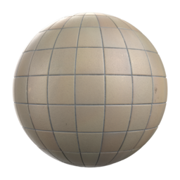</a> <b><a href="Tiles001">Tiles 001</a></b> by ambientCG · <a href="https://ambientcg.com/a/Tiles001">source</a> | <a href="Tiles002">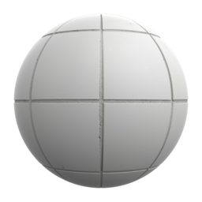</a> <b><a href="Tiles002">Tiles 002</a></b> by ambientCG · <a href="https://ambientcg.com/a/Tiles002">source</a> | <a href="Tiles003">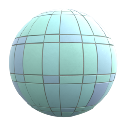</a> <b><a href="Tiles003">Tiles 003</a></b> by ambientCG · <a href="https://ambientcg.com/a/Tiles003">source</a> | <a href="Tiles004">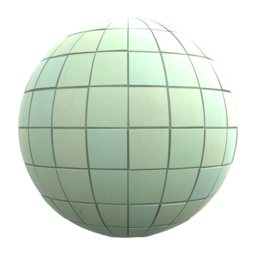</a> <b><a href="Tiles004">Tiles 004</a></b> by ambientCG · <a href="https://ambientcg.com/a/Tiles004">source</a> |
| <a href="Tiles005">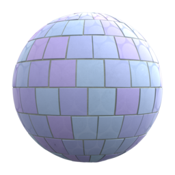</a> <b><a href="Tiles005">Tiles 005</a></b> by ambientCG · <a href="https://ambientcg.com/a/Tiles005">source</a> | <a href="Tiles006">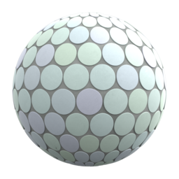</a> <b><a href="Tiles006">Tiles 006</a></b> by ambientCG · <a href="https://ambientcg.com/a/Tiles006">source</a> | <a href="Tiles007">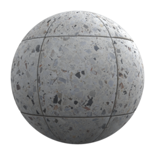</a> <b><a href="Tiles007">Tiles 007</a></b> by ambientCG · <a href="https://ambientcg.com/a/Tiles007">source</a> | <a href="Tiles008">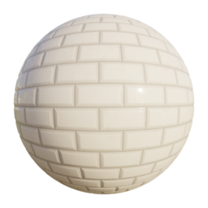</a> <b><a href="Tiles008">Tiles 008</a></b> by ambientCG · <a href="https://ambientcg.com/a/Tiles008">source</a> |
| <a href="Tiles009">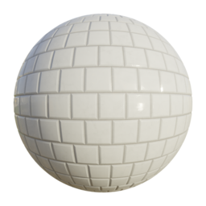</a> <b><a href="Tiles009">Tiles 009</a></b> by ambientCG · <a href="https://ambientcg.com/a/Tiles009">source</a> | <a href="Tiles010">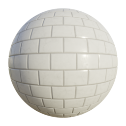</a> <b><a href="Tiles010">Tiles 010</a></b> by ambientCG · <a href="https://ambientcg.com/a/Tiles010">source</a> | <a href="Tiles011">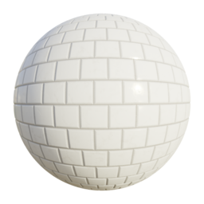</a> <b><a href="Tiles011">Tiles 011</a></b> by ambientCG · <a href="https://ambientcg.com/a/Tiles011">source</a> | <a href="Tiles012">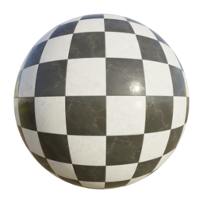</a> <b><a href="Tiles012">Tiles 012</a></b> by ambientCG · <a href="https://ambientcg.com/a/Tiles012">source</a> |
| <a href="Tiles013">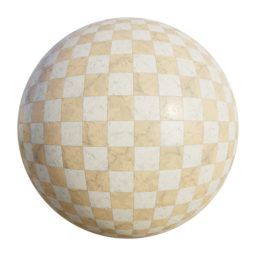</a> <b><a href="Tiles013">Tiles 013</a></b> by ambientCG · <a href="https://ambientcg.com/a/Tiles013">source</a> | <a href="Tiles014">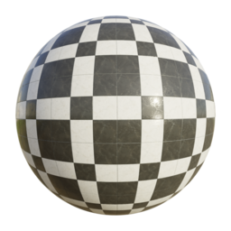</a> <b><a href="Tiles014">Tiles 014</a></b> by ambientCG · <a href="https://ambientcg.com/a/Tiles014">source</a> | <a href="Tiles015">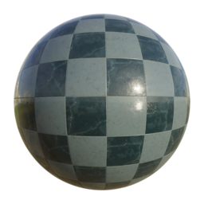</a> <b><a href="Tiles015">Tiles 015</a></b> by ambientCG · <a href="https://ambientcg.com/a/Tiles015">source</a> | <a href="Tiles016">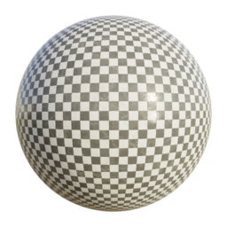</a> <b><a href="Tiles016">Tiles 016</a></b> by ambientCG · <a href="https://ambientcg.com/a/Tiles016">source</a> |
| <a href="Tiles017">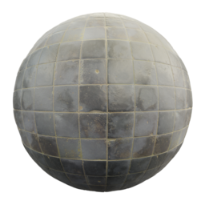</a> <b><a href="Tiles017">Tiles 017</a></b> by ambientCG · <a href="https://ambientcg.com/a/Tiles017">source</a> | <a href="Tiles018">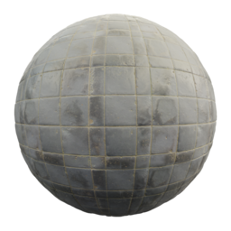</a> <b><a href="Tiles018">Tiles 018</a></b> by ambientCG · <a href="https://ambientcg.com/a/Tiles018">source</a> | <a href="Tiles019">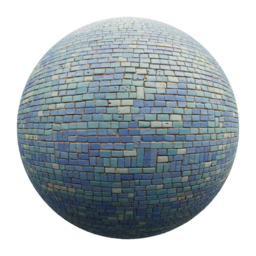</a> <b><a href="Tiles019">Tiles 019</a></b> by ambientCG · <a href="https://ambientcg.com/a/Tiles019">source</a> | <a href="Tiles020">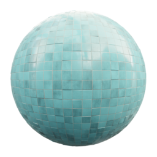</a> <b><a href="Tiles020">Tiles 020</a></b> by ambientCG · <a href="https://ambientcg.com/a/Tiles020">source</a> |
| <a href="Tiles021">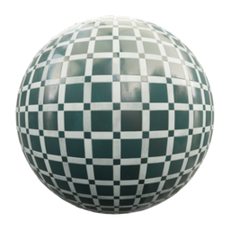</a> <b><a href="Tiles021">Tiles 021</a></b> by ambientCG · <a href="https://ambientcg.com/a/Tiles021">source</a> | <a href="Tiles022">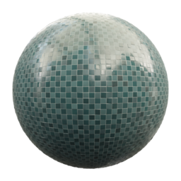</a> <b><a href="Tiles022">Tiles 022</a></b> by ambientCG · <a href="https://ambientcg.com/a/Tiles022">source</a> | <a href="Tiles023">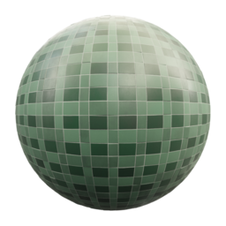</a> <b><a href="Tiles023">Tiles 023</a></b> by ambientCG · <a href="https://ambientcg.com/a/Tiles023">source</a> | <a href="Tiles024">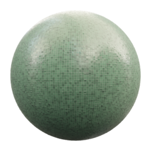</a> <b><a href="Tiles024">Tiles 024</a></b> by ambientCG · <a href="https://ambientcg.com/a/Tiles024">source</a> |
| <a href="Tiles025">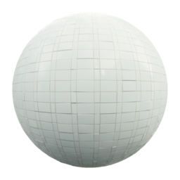</a> <b><a href="Tiles025">Tiles 025</a></b> by ambientCG · <a href="https://ambientcg.com/a/Tiles025">source</a> | <a href="Tiles026">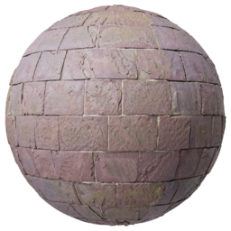</a> <b><a href="Tiles026">Tiles 026</a></b> by ambientCG · <a href="https://ambientcg.com/a/Tiles026">source</a> | <a href="Tiles027">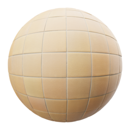</a> <b><a href="Tiles027">Tiles 027</a></b> by ambientCG · <a href="https://ambientcg.com/a/Tiles027">source</a> | <a href="Tiles028">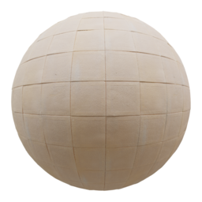</a> <b><a href="Tiles028">Tiles 028</a></b> by ambientCG · <a href="https://ambientcg.com/a/Tiles028">source</a> |
| <a href="Tiles029">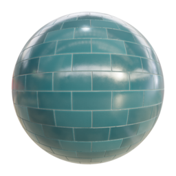</a> <b><a href="Tiles029">Tiles 029</a></b> by ambientCG · <a href="https://ambientcg.com/a/Tiles029">source</a> | <a href="Tiles030">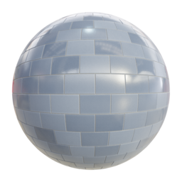</a> <b><a href="Tiles030">Tiles 030</a></b> by ambientCG · <a href="https://ambientcg.com/a/Tiles030">source</a> | <a href="Tiles031">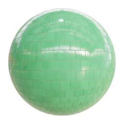</a> <b><a href="Tiles031">Tiles 031</a></b> by ambientCG · <a href="https://ambientcg.com/a/Tiles031">source</a> | <a href="Tiles032">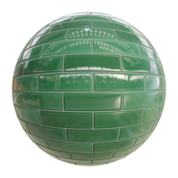</a> <b><a href="Tiles032">Tiles 032</a></b> by ambientCG · <a href="https://ambientcg.com/a/Tiles032">source</a> |
| <a href="Tiles033">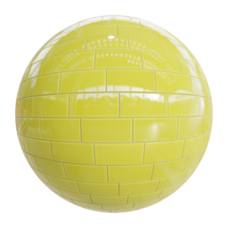</a> <b><a href="Tiles033">Tiles 033</a></b> by ambientCG · <a href="https://ambientcg.com/a/Tiles033">source</a> | <a href="Tiles034">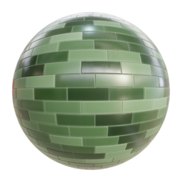</a> <b><a href="Tiles034">Tiles 034</a></b> by ambientCG · <a href="https://ambientcg.com/a/Tiles034">source</a> | <a href="Tiles035">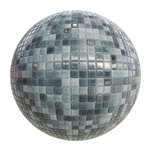</a> <b><a href="Tiles035">Tiles 035</a></b> by ambientCG · <a href="https://ambientcg.com/a/Tiles035">source</a> | <a href="Tiles036">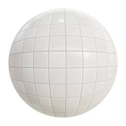</a> <b><a href="Tiles036">Tiles 036</a></b> by ambientCG · <a href="https://ambientcg.com/a/Tiles036">source</a> |
| <a href="Tiles037">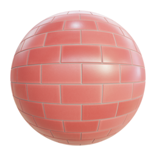</a> <b><a href="Tiles037">Tiles 037</a></b> by ambientCG · <a href="https://ambientcg.com/a/Tiles037">source</a> | <a href="Tiles038">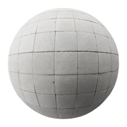</a> <b><a href="Tiles038">Tiles 038</a></b> by ambientCG · <a href="https://ambientcg.com/a/Tiles038">source</a> | <a href="Tiles039">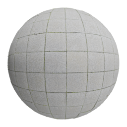</a> <b><a href="Tiles039">Tiles 039</a></b> by ambientCG · <a href="https://ambientcg.com/a/Tiles039">source</a> | <a href="Tiles040">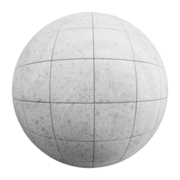</a> <b><a href="Tiles040">Tiles 040</a></b> by ambientCG · <a href="https://ambientcg.com/a/Tiles040">source</a> |

---

Kept up to date by this repository's own [update workflow](.github/workflows/update.yml), with code and plan from [cc0-mirror](https://github.com/zuujis-cc0/cc0-mirror). Something wrong? [Open an issue there](https://github.com/zuujis-cc0/cc0-mirror/issues/new) or use the [private report form](https://games.zuujis.com/report).
